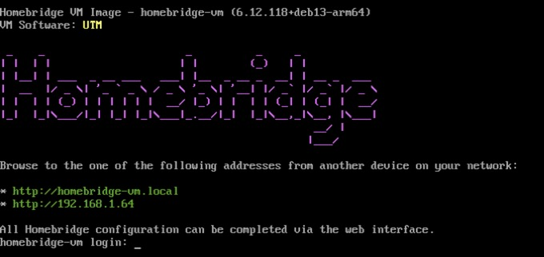

# Homebridge VM Image

A preconfigured Debian Virtual Disk Image for x86 and ARM CPU architectures that runs Homebridge.

Recommended for use on non-Linux based systems where Docker cannot be used, such as Windows or macOS.

The virtual disk is created similar to how the Homebridge Raspbian image is created, and leverages Debian as the operating system, with Node.js, Homebridge, and the Homebridge UI already installed.

<p align="center">
  
</p>

## Documentation

**For installation instructions, system requirements, and usage guides, please visit the [Homebridge VM Image Wiki](https://github.com/homebridge/homebridge/wiki/Install-Homebridge-on-Virtual-Machine).**

The wiki includes:
- Detailed installation instructions for all platforms (Hyper-V, VirtualBox, UTM, QEMU/KVM)
- CPU architecture and system requirements
- First boot setup guide
- Virtual disk specifications
- Release stream information (Stable, Beta, Alpha)
- Configuration reference
- Troubleshooting guides

## Available Formats

### Appliance Images (Ready to Import)
- **OVA** - VirtualBox Open Virtual Appliance
- **UTM** - UTM Appliance for macOS
- **HyperV** - Microsoft Hyper-V Virtual Machine (Windows 10/11 Enterprise, Pro, or Education)

### Virtual Disk Images (Manual Setup)
- **QCOW2** - QEMU/KVM Virtual Hard Disk
- **VDI** - Virtual Disk Image (VirtualBox)
- **VHDX** - Microsoft Hyper-V Virtual Hard Disk
- **VMDK** - VMware Virtual Hard Disk

### Supported CPU Architectures
- **amd64** - 64-bit Intel/AMD processors
- **arm64** - 64-bit ARM processors (including Apple Silicon Macs)

## Release Streams

| Stream | Node.js | Homebridge | UI | FFmpeg | Best For |
|--------|---------|------------|-----|--------|----------|
| **Stable** | LTS | Latest | Latest | Latest | Production use |
| **Beta** | Current | Beta | Beta | Latest | Testing new features |
| **Alpha** | Current | Alpha | Alpha | Latest | Experimental/development |

**Beta and alpha may include features not yet in `latest`.** When they do, the release notes for that build have a **Pre-release Changes** section listing them and the branch the image was built from.

---

## Developer Documentation

The following sections are intended for developers and contributors working on the Homebridge VM Image build system.

### Repository Structure

```
homebridge-vm-image/
├── build-debian-image.sh   # Builds the raw disk image (.img)
├── scripts/                # Build, test, packaging and release scripts (lib.sh: shared helpers)
├── assets/                 # What goes into the image: one folder per build stage
├── stable/ beta/ alpha/    # package.json per release stream: the versions that are built
├── tests/                  # Script tests (run on every pull request)
└── .github/                # Release workflows, pull request checks, local actions
```

### What the image is

- Debian 13 ("trixie"), with the Debian sources for updates and security fixes.
- The Homebridge apt package from `repo.homebridge.io` (it brings Node.js, Homebridge and the UI), at the exact version in `<stream>/package.json`.
- ffmpeg from `ffmpeg-for-homebridge`, nginx in front of the UI (ports 80 and 443), and the `hb-config` tool.
- Debian security fixes are installed automatically (`unattended-upgrades`). The VM is never restarted by that, and the Homebridge package and Node.js are never touched by it.
- The raw image is 5 GB. Every released disk format and package has a 50 GB virtual disk (the files stay small). The system grows into its disk at every start, with no questions asked.

Things that are made on each VM at its first start, and are never in the image:

- the SSH host keys and the machine id,
- the nginx certificate,
- the user account (the setup wizard on the console asks for it).

The timezone is looked up once, the first time the VM starts with a network, and never when a timezone was already set (`hb-timezone-once.service`).

### Build and Packaging Scripts

#### Main Build Scripts

- **`build-debian-image.sh <arm64|amd64> [stable|beta|alpha] [release tag]`**
  Builds the raw image: disk image and partitions, Debian base system, packages, the stages in `assets/`, boot loader. Needs Linux and root rights. The output is `output/homebridge-vm-image-<stream>-<arch>.img` and a `.manifest` file. It does not compress anything.
- **`scripts/chroot-base-setup.sh`**
  The part of the build that runs inside the new system (packages, boot loader, fstab).
- **`scripts/seal-image.sh`**
  The last build step: takes out what must not be the same in every copy (SSH host keys, machine id, caches).
- **`scripts/install-build-deps.sh <arch>`**
  Installs the packages the build and the boot test need on the build machine. The release workflow, the pull request workflow and `scripts/Dockerfile` all use this one list.
- **`scripts/local-build-in-docker.sh [arch] [stream]`**
  Runs `build-debian-image.sh` in a Docker container, for macOS and other non-Linux hosts.
- **`scripts/boot-test.sh <image> <arch> [release tag] [apt version]`**
  Starts a built image as a real VM under QEMU (UEFI, GRUB, kernel, systemd) and checks it from the inside with `scripts/boot-test-checks.sh`. The release workflow runs it on the amd64 image before anything is published. GitHub's arm runners have no KVM, so the arm64 image is checked on real hardware (UTM on Apple Silicon) instead.

#### Platform-Specific Packaging

- **`scripts/convert-img-to-virtual-disk.sh`**
  Converts the raw image to QCOW2, VHDX and VMDK, each with a 50 GB virtual disk.
- **`scripts/package-for-virtual-box.sh [arch] [stream]`**
  Makes the VDI disk and the VirtualBox appliance (OVA). Needs VirtualBox.
- **`scripts/package-for-utm.sh [arch] [stream]`**
  Makes the UTM bundle (`.utm.tgz`). Needs a Mac with UTM.
- **`scripts/create-release-body.sh <stream>`**
  Writes the release notes.

#### Local tools (no workflow runs these)

- **`scripts/validate-utm-package.sh`**, **`scripts/local-validate-virtual-box-package.sh`**, **`scripts/local-clean-up.sh`**
  Helpers for trying a package by hand on a Mac with UTM or VirtualBox. They are not covered by the tests.

### VM Image Scripts

These scripts are in the VM image:

| Script | When it runs | What it does |
|--------|--------------|--------------|
| `/usr/local/sbin/first-boot-homebridge` | at every start until an account exists, on the console | The setup wizard: asks for a user name and a password and makes the account |
| `/usr/local/sbin/expandVirtualFilesystem` | at every start, and from `hb-config` | Grows the root file system into the virtual disk. Does nothing when there is nothing to grow |
| `/usr/local/sbin/updateIssueVMName` | at every start | Writes the name of the VM program on the login screen, once |
| `/usr/local/sbin/hb-timezone-once` | at the start, until it worked once | Looks up the timezone |
| `/usr/local/sbin/hb-config` | `sudo hb-config` | The configuration tool |
| `/etc/hb-service/homebridge/prestart.d/20-hb-nginx-check` | before every Homebridge start | Points nginx at the port of the UI |

`sudo hb-config` → **Update** also brings a VM that was made from an older image up to date (Debian security sources, SSH host keys of its own, time sync). On a VM from a current image it changes nothing.

### Tests

```bash
docker run --rm -v "$PWD":/repo:ro -w /repo debian:trixie-slim bash -c '
  apt-get update -qq &&
  apt-get install -y -qq --no-install-recommends bash ca-certificates dash git jq nginx openssl passwd python3 python3-yaml qemu-utils > /dev/null &&
  git config --global --add safe.directory /repo &&
  tests/run.sh'
```

See [`tests/README.md`](tests/README.md). Every pull request runs the tests, `shellcheck`, `actionlint`, and installs the build machine's packages on both runner images (`.github/workflows/ci.yml`).

### Local Development Builds

Build the image, then test the boot (both inside Docker, on any host):

```bash
./scripts/local-build-in-docker.sh arm64 stable
```

Package it (on a Mac, with UTM or VirtualBox installed):

```bash
./scripts/package-for-utm.sh arm64 stable
./scripts/package-for-virtual-box.sh arm64 stable
```

### Release Workflow

Releases are fully automatic. Nothing is published unless the built image starts and passes the boot test.

#### Stage 1: Update Dependencies (`release-stage-1_update_dependencies`)

**Trigger:** every day at 10:00 UTC, or by hand.

For each release stream (stable, beta, alpha), one after the other:

1. `homebridge-dependency-bot` looks for new versions and pushes them to `<stream>/package.json` on `latest`.
2. A build (Stage 2) is started when the bot found new versions, **or** when the versions on the branch are not the ones in the newest release of that stream (`scripts/unreleased-versions.sh`). So a build that failed is tried again the next day.
3. Stage 1 waits for Stage 2 and **fails when the build or the release fails**.

#### Stage 2: Build and Push Images (`release-stage-2_build_and_push_images`)

**Inputs:** the release stream.

1. Sets the release tag: `YYYY-MM-DD` for stable, `beta-YYYY-MM-DD` and `alpha-YYYY-MM-DD` for the others.
2. Builds the image for arm64 and amd64, each on a runner of that CPU type.
3. **Boot test (amd64):** starts the image as a VM and checks it. A failed test stops here: nothing is uploaded and no release is made. arm64 is not booted on GitHub (its arm runners have no KVM); check it in UTM before promoting a release.
4. Uploads the images as artifacts, starts Stage 3 and waits for it.

This workflow can be started by hand at any time.

#### Stage 3: Package Release (`release-stage-3_package_release`)

**Inputs:** the run id of Stage 2, the release stream, the release tag.

1. Writes the release notes and creates the GitHub release as a **pre-release**. If the release exists already (a second build on the same day), its files stay in place and are replaced one by one.
2. Converts the images to QCOW2, VHDX and VMDK and uploads them.
3. Starts the three Stage 4 workflows and waits for them.
4. Only after all of them passed:
   - a stable release is marked as not a pre-release and as **latest**,
   - for beta and alpha, releases older than the newest **five** are deleted, with their tags. A link to a file of an older beta or alpha release stops working then.

#### Stage 4: Package for VM (`release-stage-4_package-for-utm`, `-virtualbox`, `-hyperv`)

**Inputs:** the run id of Stage 2, the release stream, the release tag.

1. Builds the VM packages: UTM (`scripts/package-for-utm.sh`, on macOS), VirtualBox (`scripts/package-for-virtual-box.sh`), Hyper-V (PowerShell, on Windows; v8.0 and v10.0, amd64 and arm64).
2. A second job, which installs nothing from outside, adds the packages to the release.

These workflows can be run again; they replace the packages of the release.

**One UTM package, one VM UUID and network address.** UTM will not import a package without a VM
UUID and a network card address, so every VM made from the same `.utm.tgz` starts with the same
two. The machine id is fixed in the VM: `hb-machine-id.service` replaces an id taken from the VM
UUID with a random one. The network address can only be changed in UTM: to run two VMs from the
same package on one network, give one of them a new address (VM settings → Network → Random).
VirtualBox makes new addresses when it imports an OVA.

### What must not change by accident

Users, the wiki and other Homebridge projects use these by name:

- **Release tags:** `YYYY-MM-DD`, `beta-YYYY-MM-DD`, `alpha-YYYY-MM-DD`. "Latest release" is always the newest stable.
- **Release file names:** `homebridge-vm-image-<stream>-<arch>` followed by `.ova`, `.utm.tgz` (arm64 only), `-hyperv8.0.zip`, `-hyperv10.0.zip`, `.qcow2`, `.vdi.gz`, `.vhdx.gz`, `.vmdk.gz`, `.manifest`.
- **Inside the Hyper-V zip:** the folders `Snapshots`, `Virtual Hard Disks`, `Virtual Machines` at the top level.
- **Files on branch `latest` that are linked from outside:** `assets/01-homebridge/files/hb-config` (the Update menu of older VMs downloads it), `assets/Console.png`, `assets/First Boot.png`, `README-deprecated.md`.
- **Files in the VM that other code reads:** `/etc/hb-ui-port`, `/etc/hb-release`, `/opt/homebridge/source-vm.sh` (variables `VM_SOFTWARE`, `HOMEBRIDGE_VM_IMAGE_VERSION`, `FFMPEG_FOR_HOMEBRIDGE_VERSION`, `HOMEBRIDGE_APT_PKG_VERSION`), the host name `homebridge-vm`, and ports 80, 443 and 8581.

### Troubleshooting VM Boot Issues

#### View All Boot Messages
```bash
sudo journalctl -b
```

#### Check First Boot Service
```bash
sudo journalctl -u first-boot-homebridge -b
```

#### Check the disk growth and the timezone lookup
```bash
sudo journalctl -u hb-expand-rootfs -u hb-timezone-once -b
cat /var/log/diskexpand.log
```

---

## Contributing

Contributions are welcome! Please ensure:
- All changes are tested thoroughly before submitting PRs (`tests/run.sh`, and a build with `scripts/local-build-in-docker.sh` where the image changes)
- Build scripts maintain compatibility with both amd64 and arm64 architectures
- Documentation is updated to reflect any changes
- Follow existing code style and conventions

## Support

- **Issues:** [GitHub Issues](https://github.com/homebridge/homebridge-vm-image/issues)
- **Wiki:** [Installation and Usage Documentation](https://github.com/homebridge/homebridge/wiki/Install-Homebridge-on-Virtual-Machine)
- **Discord:** [Homebridge Community](https://discord.gg/homebridge)

## License

This project is licensed under the Apache-2.0 License - see the LICENSE file for details.
